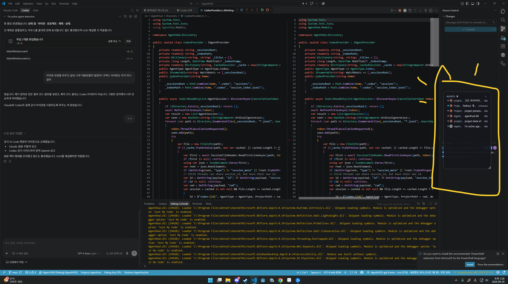
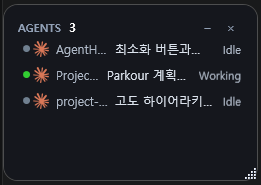
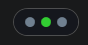
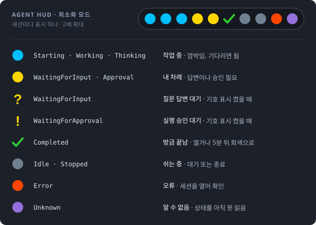
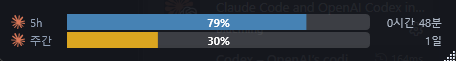
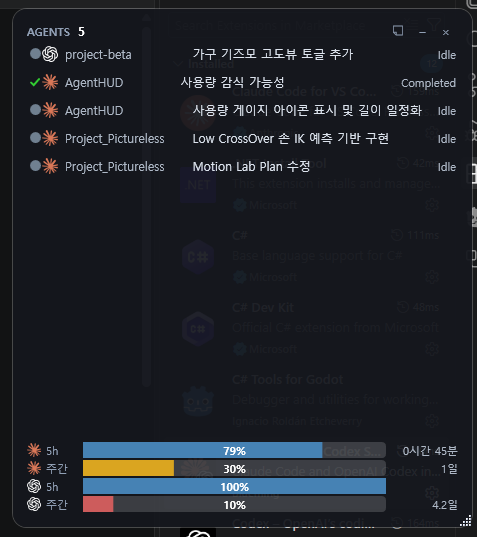

# Agent HUD

**Agent HUD is a free, open-source desktop overlay for monitoring multiple Claude Code, OpenAI Codex, and OpenCode sessions at once.** It shows which agent is working, waiting for your answer or approval, finished, or stopped by a usage limit. Windows and macOS are supported.

Use it if you want to:

- See agent sessions across projects in one always-on-top panel
- Know when an agent finishes or needs your input without checking every window
- Jump from a session to its VS Code project and conversation
- Track 5-hour and weekly usage limits
- Get notified when a usage limit resets and optionally resume the session

There is nothing to register for session monitoring. Start Agent HUD and leave it running while you use your coding agents.



| Default panel | Minimized |
| --- | --- |
|  |  |

Click the `–` button in the header, or double-click the header, to shrink the HUD to a small bar. Hover a dot to see its project and status, drag the bar to move it, and double-click it to restore the full panel.



## Features

- Automatically finds Claude Code, Codex, and supported OpenCode sessions and groups them by project
- Shows working, thinking, waiting for input or approval, completed, stopped, error, and usage-limit states
- Borderless, always-on-top HUD with saved position and a compact minimized mode
- Double-click a session to bring its project forward in VS Code and open its conversation when supported
- Appears on every Windows virtual desktop
- Hide individual sessions with `×`; waiting or completed sessions reappear when they need attention
- Global and per-project memos
- Cleanup window for agent process trees left behind by closed chat tabs, with shared and active sessions protected (Windows)
- Optional sounds for completion and input or approval requests
- Remaining usage gauges with reset times and an even-pace marker; Claude limits work out of the box, no setup needed
- Usage-limit notifications and optional automatic resume
- Update check on Windows: a new release shows a small dot in the header and an install item in the right-click menu; nothing installs without your confirmation
- English and Korean UI, following the system language by default or selectable in Settings

## Install on Windows

Download a ZIP from the [Releases](https://github.com/garunnir/AgentHUD/releases) page, extract it, and run `AgentHud.exe`.

- `win-x64.zip` requires the [.NET 9 Desktop Runtime](https://dotnet.microsoft.com/download/dotnet/9.0).
- `win-x64-self-contained.zip` includes the runtime.
- New versions are offered quietly: a dot appears in the header and the right-click menu shows **Install vX.Y.Z…**. After you confirm, the HUD replaces its files and restarts. Keep the extracted folder somewhere writable (not `Program Files`); otherwise the release page opens instead. Turn off **Check for updates automatically** in Settings > General to opt out.
- Windows 11 is recommended. Windows 10 works, but the HUD follows the active desktop instead of being pinned to every virtual desktop.

Install at least one supported agent: Claude Code, Codex, or OpenCode. Git itself is optional.

## Using the HUD

### Session actions

- Double-click a session to open its project and conversation in VS Code.
- Hover a session and click `×` to hide it. If it later needs input or completes, it reappears automatically.
- Right-click the HUD and choose **Show hidden sessions** to restore every hidden session. Hidden state resets when Agent HUD exits.
- Use the memo button in the header for a general note. Right-click a session and choose **Project memo...** for a project-specific note.

### Cleaning up old sessions (Windows)

Every Claude Code or Codex chat tab you open in VS Code starts its own `claude.exe` / `codex.exe`, and each of those starts its own MCP children (`uvx`, `python`, `node`, relay executables, shells). Tabs you never closed keep all of that alive, which can add up to gigabytes. Right-click the HUD and choose **Clean up old sessions...** (or Settings → General → **Open...**) to see what is running and terminate what you no longer need.

Each row is one agent process tree: agent, PID, conversation title and project (or *(no session, orphan)* when nothing in the HUD matches it), state, last activity, start time, how many processes the tree holds, and its total memory. The footer shows the total for every tree and for your current selection. Opening the window only lists — nothing is terminated until you select rows and confirm the dialog.

- **Select all but latest** keeps the N most recent eligible session trees (by last activity) and selects the rest. Trees with no matching session (*orphan* or *unknown*) are never auto-selected, since they may belong to scripts or other tools; check them by hand if you want them gone. N is saved in Settings.
- **Include active sessions** lets a session that is working or waiting for input or approval be auto-selected. It is off by default.
- **Terminate selected** kills the agent process and its children, after a confirmation dialog that shows the process count and memory to be freed. Results are reported in the window and appended to `%LOCALAPPDATA%\AgentHud\cleanup.log`.

Safety rules, applied before anything can be selected:

- Only an agent process and its own descendants are ever terminated. Whatever started them — VS Code, the extension host, your shell — is an ancestor, never part of the tree.
- A tree that contains VS Code, Agent HUD itself, or another shared process is never terminable, and neither is a process that belongs to two trees at once (for example a Codex CLI started by a Claude session).
- The Claude desktop app is also named `claude.exe`; it is recognized by its install path or its Electron child processes and is never terminable.
- A `codex app-server` process hosts several conversations at once, so it is listed but never terminable; killing it would disconnect every open Codex tab.
- Codex sessions record no PID, so a Codex tree is only matched to a conversation when its command line carries the session id. Anything else stays *(unknown session)*: it is shown and can be checked by hand, but is never auto-selected.
- Right before each kill, the PID is read again and its name and start time are compared with the list. If a PID was recycled in the meantime, that row is skipped and reported.

### VS Code integration

For the most reliable session opening, use VS Code Stable, install the relevant Claude Code or Codex extension, and make sure the `code` command is on PATH. You can check it with:

```powershell
code --version
```

For Claude Code, set **Preferred Location** to `editor`. The extension does not currently allow another app to switch its sidebar conversation, so sidebar users are taken to the correct project window but may need to select the conversation manually.

If VS Code was closed, the extension may not be ready for the first open request. Double-click the session again after VS Code starts.

### Status colors

| Display | Meaning |
| --- | --- |
| Pulsing blue | Starting, working, or thinking |
| Yellow | Waiting for your answer or approval |
| Green check | Finished and not yet viewed |
| Gray | Idle or stopped |
| Orange-red | Error |
| Pink | Usage limited |
| Purple | Status unavailable or unrecognized |

Turn on **Settings → Show waiting states as symbols (? / !)** to show questions as `?` and approvals as `!` instead of yellow dots. This applies to both the full and minimized views.

An unseen completion stays as a green check for up to 5 minutes. Double-clicking the session marks it as seen. Starting another command clears the old completion mark.

Detection depends on the status information each agent makes available locally. Questions written only as ordinary chat messages cannot be distinguished from regular output. Some Codex command approval windows do not expose their pending state, so the HUD can remain blue until the command continues.

### Sounds and notifications

Settings lets you enable separate sounds for completion and input or approval requests. You can preview the built-in sounds or choose custom sound files.

When a usage limit resets, Agent HUD can show a notification at the bottom right and play a sound. The notification does not steal focus and remains until you close or click it. You can restrict notifications to sessions currently shown in the HUD.

## Usage gauges



The bottom of the expanded HUD shows each detected service's remaining usage, percentage, and time until reset. Bars turn yellow at 70% used and red at 90% used.

The white tick is the pace marker: the amount you would have left if you spent the limit evenly throughout the window. A bar ending left of the tick means usage is ahead of that pace.



### Codex

Codex usage works automatically with no setup.

### Claude

Claude usage limits work out of the box: Agent HUD registers a Claude Code status line on first run (**Settings → Claude → Link real Claude limits**), which reports the official 5-hour and weekly limits. Your existing status line keeps running and is restored if you turn the option off. The same status line link is available on macOS.

The status line does not run inside the VS Code extension. If you work only there, the last value it reported stops updating, and the HUD marks it `Stale` (e.g. `42% · Stale`) rather than showing an increasingly stale number as if it were current. Once the window it describes has already reset, the old percentage is meaningless and the HUD shows just `Stale` instead.

Advanced: **Settings → Claude → Use the claude.ai usage API** fetches usage from an unofficial claude.ai endpoint using your web session cookie (Organization ID + `sessionKey`). It is off unless you explicitly turn it on, it is mainly useful for VS Code extension users, and the cookie is encrypted with Windows DPAPI and stored locally. The cookie expires and must be entered again. (Windows only — there is no sessionKey API on macOS.)

Agent HUD uses whichever source has the fresher valid value: a status line snapshot is discarded once it is over 12 hours old or once Claude session activity is newer than it (meaning work happened where the status line does not run); an API value is discarded once it is over 30 minutes old. On a tie the status line wins, since it is the official number for the account the CLI is signed in to. Values are never mixed between the two sources.

Without any limit data, Agent HUD estimates recent token use from detected sessions; set a budget in Settings to show a gauge against it.

### OpenCode Go

Open **Settings → OpenCode Go usage**, enter the workspace ID from your Console URL, log in, and click Save. Agent HUD shows the available 5-hour, weekly, and monthly limits. Logout removes the saved login. This unofficial Console connection does not cover other API providers.

## Auto-resume after usage limits

Turn on **Settings → Resume automatically after a usage limit resets** to resume Claude Code or Codex about one minute after the reset. Agent HUD sends the message configured in Settings to the same session.

- File edits can be automatically approved. Other commands still follow the agent's permission rules and may be denied because no approval window is available during unattended resume.
- Progress from an automatic resume may not appear live in a conversation tab that was already open. Double-click the session in the HUD before continuing there.
- Sessions whose limits reset more than 30 minutes ago and subagent sessions are not resumed.
- If the resumed turn reaches another limit, Agent HUD can try again after the new reset.

## OpenCode on Windows

OpenCode sessions are detected automatically. Current support includes project and title display, activity and completion for supported local session formats, and input waiting for legacy question tools. Permission prompts, V2 input waits, and automatic resume are not currently available. Double-clicking opens the project in VS Code.

## macOS

Download `macos-arm64.zip` for Apple Silicon or `macos-x64.zip` for Intel from the [Releases](https://github.com/garunnir/AgentHUD/releases) page. Agent HUD requires macOS 14 or later. Extract the ZIP and move `AgentHud.app` to Applications.

The app is ad-hoc signed and not notarized, so the first launch may need to be allowed in **System Settings → Privacy & Security**. Some features and settings differ from Windows.

For macOS questions and bug reports, please [open an issue](https://github.com/garunnir/AgentHUD/issues) and mention [@hail-kang](https://github.com/hail-kang).

## Privacy

Agent HUD has no telemetry. Session monitoring reads local agent files. The default Claude status line path makes no network request of its own. On Windows, the update check sends an anonymous request to the GitHub releases API at startup and every 6 hours (can be turned off in Settings). Other network access is used only for usage services you configure, such as the opt-in claude.ai cookie API; macOS can also query Codex and OpenCode Go usage endpoints for its gauges.

## FAQ

### Can I monitor Claude Code, Codex, and OpenCode together?

Yes. Available sessions are shown in one list and grouped by project.

### Why did double-clicking open the project but not the conversation?

The agent extension may not support switching that type of conversation externally. Claude sidebar conversations in particular must be selected inside the sidebar. Using editor tabs gives the best result.

### Why is a waiting session still blue?

The HUD can only show a waiting state when the agent records it locally. Some ordinary chat questions and app-generated command approval windows do not expose that state.

### Does Agent HUD upload my conversations?

No. Session monitoring is local. Optional usage connections send only the requests needed for those configured services.

## Contributing and technical documentation

Bug reports and PRs are welcome. See [CONTRIBUTING.md](CONTRIBUTING.md) for building, tests, and contribution rules.

Internal architecture and integration details are in [docs/architecture.md](docs/architecture.md). AI coding agents should start with [AGENTS.md](AGENTS.md).
